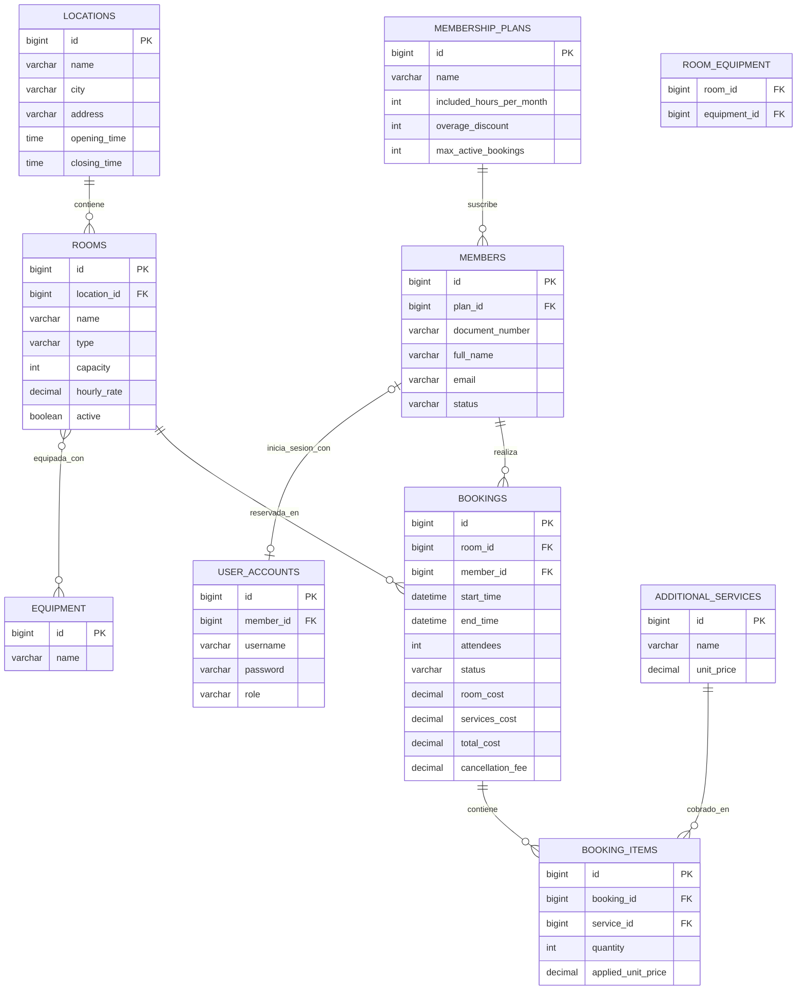

# CoWorkHub — Análisis, modelo y trazabilidad

Documento de análisis del proyecto final. Complementa el enunciado e incorpora el
requisito adicional acordado: **interfaz web con JavaScript** además de la API REST.
Los 14 escenarios de aceptación del enunciado se mantienen sin cambios.

---

## 1. Actores y casos de uso

| Actor | Descripción | Casos de uso principales |
|---|---|---|
| **ADMIN** | Empleado con control total del sistema. Único rol que administra catálogos. | Gestionar sedes, salas, equipamiento, servicios y planes. Registrar, actualizar, suspender, reactivar y eliminar miembros. Gestionar reservas y consultar consumo de cualquier miembro. |
| **RECEPTIONIST** | Empleado de recepción. Opera el día a día con miembros y reservas, sin tocar catálogos. | Registrar y mantener miembros. Crear reservas a nombre de cualquier miembro. Confirmar, cancelar y completar reservas. Consultar disponibilidad y consumo de cualquier miembro. |
| **MEMBER** | Cliente del coworking con plan de membresía y cuenta propia. | Iniciar sesión, consultar catálogos y disponibilidad, crear/ver/modificar/cancelar **sus** reservas y ver **su** consumo. |
| *Público* | Visitante sin token. | Iniciar sesión, consultar salud del servicio y documentación. |

### Casos de uso (resumen)

1. **Autenticarse** (`POST /auth/login`): valida credenciales BCrypt y devuelve un JWT de 60 minutos.
2. **Consultar perfil** (`GET /auth/perfil`): usuario, rol y `miembroId` del token.
3. **Gestionar catálogos**: CRUD de sedes, salas (con equipamiento), equipamiento, servicios adicionales y planes. Escritura solo `ADMIN`.
4. **Gestionar miembros**: alta transaccional de `Member` + `UserAccount`, listado con filtros, actualización, suspensión/reactivación y baja.
5. **Consultar disponibilidad**: salas libres de una sede para fecha y rango horario, con filtros de capacidad y equipamiento.
6. **Reservar**: alta de reserva con servicios; el sistema valida RN-01 a RN-07 y devuelve el costo calculado.
7. **Consultar reservas**: por id, por miembro, por sala y fecha, o por estado.
8. **Modificar servicios** de una reserva `PENDING` y recalcular el costo.
9. **Cambiar estado**: confirmar, cancelar (con RN-08) y completar.
10. **Consultar consumo mensual**: horas incluidas, usadas, restantes y excedentes.
11. **Operar la interfaz web**: el mismo conjunto de casos, desde el navegador, respetando el rol del usuario autenticado.

---

## 2. Glosario

| Término | Definición |
|---|---|
| **Reserva** | Bloque de uso de una sala por un miembro, con fecha, hora de inicio y fin, asistentes, servicios adicionales y estado (`PENDING`, `CONFIRMED`, `COMPLETED`, `CANCELLED`). |
| **Plan** | Membresía contratada por un miembro. Define las horas incluidas por mes, el descuento sobre horas excedentes y el máximo de reservas activas simultáneas. |
| **Horas incluidas** | Horas que el plan cubre sin costo adicional en el mes calendario. Se consumen con las reservas del miembro y no generan cargo mientras haya saldo. |
| **Horas excedentes** | Horas reservadas por encima de las incluidas en el mes. Se cobran a `hourlyRate × (1 − overageDiscount/100)` de la sala reservada. |
| **Solapamiento** | Cruce temporal entre dos reservas `PENDING` o `CONFIRMED` de la misma sala. Dos intervalos que solo se tocan en un extremo (una termina cuando la otra empieza) **no** se solapan. |
| **Cargo por cancelación** | Importe que se cobra al cancelar según la anticipación: `0` con 24 h o más, `50 %` del costo de la sala entre 24 h y 2 h, y cancelación rechazada con menos de 2 h o si la reserva ya comenzó. |

---

## 3. Modelo entidad-relación

### Decisiones de mapeo JPA

| Relación | Lado dueño | `fetch` | `cascade` / `orphanRemoval` | Justificación |
|---|---|---|---|---|
| `Location` 1→N `Room` | `Room` (`@ManyToOne`) | `LAZY` | ninguno | La sala conoce su sede; borrar una sede no debe arrastrar salas (RN-12 lo impide antes). |
| `Room` N↔N `Equipment` | `Room` (`@ManyToMany` + `@JoinTable`) | `LAZY` | ninguno | El equipamiento es un catálogo compartido; borrar una sala no borra equipamiento. |
| `MembershipPlan` 1→N `Member` | `Member` (`@ManyToOne`) | `LAZY` | ninguno | El plan no contiene a sus miembros; RN-12 impide borrar un plan en uso. |
| `Member` 1↔1 `UserAccount` | `UserAccount` (`@OneToOne` + FK `member_id` única) | `LAZY` | ninguno | La cuenta pertenece al miembro; se crean juntas en el alta pero se gestionan por separado. |
| `Member` 1→N `Booking` | `Booking` (`@ManyToOne`) | `LAZY` | ninguno | La reserva referencia a su miembro; RN-12 impide borrar un miembro con reservas. |
| `Room` 1→N `Booking` | `Booking` (`@ManyToOne`) | `LAZY` | ninguno | Misma lógica que la anterior. |
| `Booking` 1→N `BookingItem` | `Booking` (`@OneToMany(mappedBy="booking")`) | `LAZY` | `cascade = ALL`, `orphanRemoval = true` | El detalle no existe sin la reserva: se guarda y se borra con ella. Quitar un servicio elimina su fila. |
| `BookingItem` N→1 `AdditionalService` | `BookingItem` (`@ManyToOne`) | `LAZY` | ninguno | El detalle apunta al servicio; `appliedUnitPrice` conserva el precio histórico. |

Comprobaciones adicionales:

- `@Enumerated(EnumType.STRING)` en `RoomType`, `MemberStatus`, `BookingStatus` y `Role`.
- `BigDecimal` para dinero, `LocalTime` para horarios de sede y `LocalDateTime` para reservas.
- `nullable = false` en los campos obligatorios y `unique` en documento, email, username y `(location_id, name)` de sala.
- Colecciones `LAZY` y DTO de salida: el JSON nunca serializa entidades, así que no hay ciclos ni `LazyInitializationException`.
- Los listados usan `@EntityGraph` / `join fetch` para evitar N+1.

---

## 4. Matriz de trazabilidad

### 4.1 Requisitos funcionales → reglas → endpoints

| RF | Reglas | Endpoints | Pantalla web |
|---|---|---|---|
| RF-01 | RN-11, RN-12, RN-13 | `/api/sedes`, `/api/salas`, `/api/equipamientos`, `/api/servicios-adicionales`, `/api/planes` | Catálogos (ADMIN) |
| RF-02 | RN-05, RN-11, RN-12, RN-13 | `/api/miembros` y subrutas | Miembros (ADMIN, RECEPTIONIST) |
| RF-03 | RN-01, RN-03, RN-04 | `GET /api/disponibilidad` | Disponibilidad |
| RF-04 | RN-01 … RN-07 | `POST /api/reservas` | Nueva reserva |
| RF-05 | RN-13 | `GET /api/reservas/{id}`, `GET /api/reservas?…` | Mis reservas / Reservas |
| RF-06 | RN-10, RN-07 | `POST` y `DELETE /api/reservas/{id}/servicios…` | Detalle de reserva |
| RF-07 | RN-09 | `POST /api/reservas/{id}/confirmar` | Detalle de reserva |
| RF-08 | RN-08, RN-09 | `POST /api/reservas/{id}/cancelar` | Detalle de reserva |
| RF-09 | RN-09 | `POST /api/reservas/{id}/completar` | Detalle de reserva |
| RF-10 | RN-07, RN-08 | `GET /api/miembros/{id}/consumo` | Mi consumo |
| RF-11 | RN-13 | `POST /auth/login` | Login |
| RF-12 | RN-13 | Filtro JWT + `@PreAuthorize` en todos los endpoints | Sesión y menú por rol |
| RF-13 | — | Swagger UI y `/v3/api-docs` | — |
| RF-14 | — | `GET /auth/perfil` | Cabecera de sesión |
| RF-15 | — | `GET /actuator/health` | — |

### 4.2 Escenarios de aceptación → verificación

| # | Escenario | Resultado esperado | Cubre |
|---|---|---|---|
| 1 | Reserva de sala libre con 2 servicios | `201` + costo calculado | RF-04, RN-07 |
| 2 | Reserva que se cruza con otra | `409` `RN-01` | RF-04, RN-01 |
| 3 | Reserva 10:00–11:00 tras otra 09:00–10:00 | `201` | RN-01 (extremos) |
| 4 | Reserva de 45 min o fuera de horario | `409` | RN-02 / RN-03 |
| 5 | Cancelación con 30 h | `200`, cargo `0` | RF-08, RN-08 |
| 6 | Cancelación con 5 h | `200`, cargo 50 % de la sala | RF-08, RN-08 |
| 7 | Cancelación con 1 h | `409` | RF-08, RN-08 |
| 8 | Confirmar una reserva cancelada | `409` | RN-09 |
| 9 | Miembro consulta reserva ajena | `403` | RN-13 |
| 10 | Endpoint protegido sin token / token alterado | `401` | RF-12 |
| 11 | Eliminar sala con reservas futuras | `409` | RN-12 |
| 12 | Crear sede sin nombre | `400` | Validación |
| 13 | Dos solicitudes simultáneas, misma sala y horario | Una `201`, otra `409` | RN-01 (concurrencia) |
| 14 | `GET /api/miembros?estado=SUSPENDED` | `200` solo suspendidos | RF-02 |

Cada escenario tendrá una prueba automatizada y una solicitud en la colección de
Postman/Insomnia.

---

## 5. Supuestos y decisiones

1. **"Ahora" se inyecta.** Todo cálculo temporal usa un `Clock` configurable, para poder
   probar RN-03 y RN-08 con fechas fijas.
2. **Límites de cancelación.** Con exactamente 24 h se cancela **sin cargo**; con
   exactamente 2 h se cobra el **50 %**; con menos de 2 h se rechaza.
3. **Horas al cancelar tarde.** Con 24 h o más se devuelven las horas al plan. Entre 24 h
   y 2 h la reserva se cancela y se cobra el 50 % de la sala, pero **las horas quedan
   consumidas** (la sala estuvo bloqueada hasta la cancelación). Con menos de 2 h no hay
   cancelación.
4. **Qué reservas consumen horas.** Las `PENDING`, `CONFIRMED` y `COMPLETED` del mes de
   `startTime`; las `CANCELLED` no consumen salvo el caso del punto 3.
5. **Orden de consumo.** Las horas incluidas se consumen en orden cronológico de las
   reservas del mes; el excedente se calcula con la tarifa de la sala de cada reserva.
6. **Horas de una reserva.** Se cobran por duración exacta (múltiplos de 30 min); las
   horas incluidas se descuentan en horas decimales (45 min = 0,75 h).
7. **`totalCost` al cancelar.** Si hay cargo, `totalCost` pasa a ser el `cancellationFee`;
   `roomCost` y `servicesCost` se conservan como histórico. Sin cargo, `totalCost = 0`.
8. **`maxActiveBookings`.** Cuenta reservas `PENDING` o `CONFIRMED` con `startTime` futuro.
9. **Servicios.** El precio se congela en `appliedUnitPrice` al agregarlos. Cambiar el
   precio del catálogo no altera reservas existentes. Solo se agregan/quitan en `PENDING`;
   agregar el mismo servicio dos veces suma cantidades.
10. **Estado inicial.** Toda reserva nace `PENDING`. Solo `ADMIN`/`RECEPTIONIST` confirman
    y completan.
11. **Unicidad de email.** Se normaliza a minúsculas al guardar y comparar (RN-11).
12. **Concurrencia RN-01.** La creación de reserva bloquea la fila de la sala
    (`PESSIMISTIC_WRITE`) dentro de la transacción, de modo que dos solicitudes
    simultáneas se serializan; la segunda vuelve a validar y recibe `409`.
13. **Zona horaria.** Las horas de negocio son `LocalDateTime` en la zona del servidor
    (configurable); los `timestamp` de error se emiten en UTC ISO-8601.
14. **Frontend.** Aplicación de una sola página con JavaScript vanilla (sin build), servida
    como estático por Spring Boot, que consume la API con `fetch` y guarda el JWT solo en
    memoria/`sessionStorage`.

---

## 6. Fuera de alcance

- Pagos reales, facturación y pasarela de pago (los cargos son datos de la reserva).
- Notificaciones por email o calendario.
- Recuperación de contraseña, registro público y OAuth.
- Multi-tenant, multi-sucursal por usuario y auditoría histórica de cambios.
- Aplicación móvil nativa; la interfaz web es responsive pero no una app instalable.
- Reservas recurrentes y lista de espera.
